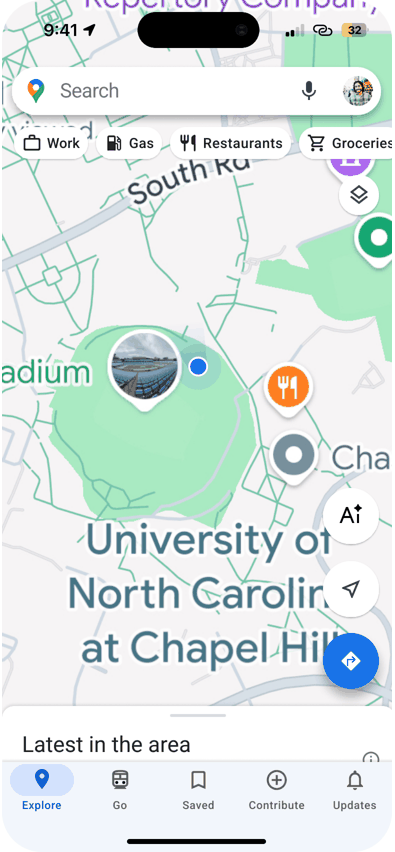

# Google Maps AI Travel Copilot

**Plan a route. Make it yours. Share the journey.**

A mobile UI/UX concept by **Chloe Jian** exploring an AI travel companion inside a familiar Google Maps experience.

[Open interactive Figma prototype ↗](https://www.figma.com/proto/HwjmctHseXWIb01dWQn4Li/Shitian_Jian_Sprint4?node-id=2-459&page-id=0%3A1&scaling=scale-down&content-scaling=fixed) · [中文介绍](README.zh-CN.md) · [Read the case study](docs/CASE_STUDY.md)

*Original mockup sequence. Click the preview to explore the Figma prototype. The animation shows design screens; it is not a recording of live AI responses.*

## The idea

Trip planning can involve jumping between maps, saved places, notes, and sharing tools. This project explores a more connected journey: gather places, create a route, review it on a map, then turn a trip into a shareable guide.

| Project | Details |
| --- | --- |
| Designer | Chloe Jian |
| Context | Independent student concept, MEJO 581, Sprint 4, UNC-Chapel Hill |
| My work | Concept development, ideation sketches, wireframes, mobile UI design, Figma prototyping, and microcopy refinement |
| Intended audience | Young travelers who plan their own trips and enjoy documenting and sharing experiences |
| Deliverables | 5 original sketch images, 11 wireframe screens, 11 final mockup screens, and an interactive Figma prototype |
| Tools | Figma; ChatGPT for English microcopy support |
| Stage | UI/UX design and interactive prototype |

## Three connected moments

- **Start with places.** Choose a saved list or add destinations from a map.
- **Review the route.** Move from a copilot conversation to a map and a detailed place list.
- **Keep and share the trip.** Explore a route-sharing sheet and a travel-itinerary concept.

The AI home also introduces “Instant Travel Guide” and “My Food Map” as feature directions. Their appearance in the menu does not establish a complete implemented service.

## Explore the work

| Document | What you will find |
| --- | --- |
| [Case study](docs/CASE_STUDY.md) | Opportunity, audience, ideation, process, reflection, and next steps |
| [Prototype and screen gallery](docs/PROTOTYPE.md) | Clickable Figma entry, verified interactions, and all 11 final screens |
| [Wireframes](docs/WIREFRAMES.md) | The complete set of 11 mobile wireframes |
| [Design decisions](docs/DESIGN_DECISIONS.md) | Choices connecting the concept to the interface |
| [Audience and scope](docs/RESEARCH_AND_SCOPE.md) | Source evidence, assumptions, and evaluation boundaries |
| [Portfolio copy](docs/PORTFOLIO_COPY.md) | Concise English and Chinese descriptions |
| [Sources](docs/SOURCES.md) | Materials reviewed and export notes |
| [Credits](CREDITS.md) | Authorship, course context, third-party assets, and AI assistance |

## Try the prototype

Open the preview, tap the **AI** button on the map, and follow **Build My Route → Choose from List → Create → My NYC Weekend Route**. The route card expands into a place list, whose share arrow opens the designed sharing sheet. These hotspot transitions were checked directly.

This is a student concept, unaffiliated with Google. The repository contains design artifacts and documentation, with no application setup required. Route generation, travel schedules, ratings, prices, opening hours, weather, flight searches, and sharing content are illustrative mockup material rather than a functioning AI or booking service. No measured usability improvement is claimed.
