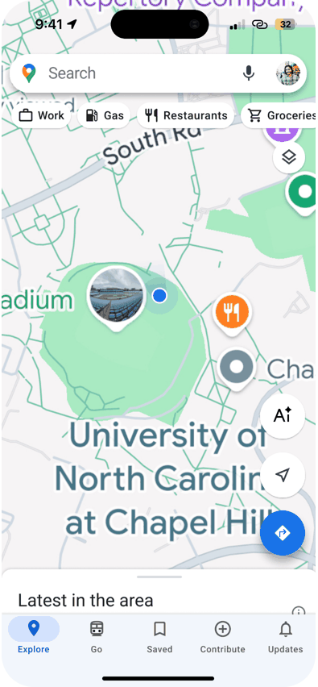

# Google Maps AI 旅行助手

**规划路线，留下记录，分享旅程。**

由 **Chloe Jian** 完成的移动端 UI/UX 概念设计，探索将 AI 旅行助手融入熟悉的 Google Maps 使用场景。

[打开 Figma 交互原型 ↗](https://www.figma.com/proto/HwjmctHseXWIb01dWQn4Li/Shitian_Jian_Sprint4?node-id=2-459&page-id=0%3A1&scaling=scale-down&content-scaling=fixed) · [English](README.md) · [完整案例](docs/CASE_STUDY.md)

*预览由原始界面图依次播放组成，点击可进入实际 Figma 原型；不是实时 AI 操作录屏。*

## 项目概念

旅行规划常常分散在地图、收藏地点、笔记和分享工具中。这个项目尝试把它们连接起来：选地点、创建路线、在地图中查看安排，再将旅程整理为可以回看和分享的旅行指南。

| 项目 | 内容 |
| --- | --- |
| 设计者 | Chloe Jian |
| 项目背景 | UNC-Chapel Hill，MEJO 581 课程 Sprint 4，个人学生概念设计 |
| 我的工作 | 概念构思、手绘草图、线框图、移动界面设计、Figma 原型与英文微文案优化 |
| 目标用户 | 喜欢自主规划旅行、记录和分享经历的年轻旅行者 |
| 交付成果 | 5 张原始草图图片、11 张移动端线框图、11 张最终界面及 Figma 交互原型 |
| 工具 | Figma；ChatGPT 辅助英文微文案 |
| 项目阶段 | UI/UX 设计与交互原型 |

## 体验主线

1. **从地点开始：**从收藏列表选择，或直接在地图上添加目的地。
2. **查看路线：**从助手对话进入地图，再展开地点列表。
3. **记录与分享：**探索路线分享面板及旅行行程单的呈现方式。

AI 首页还提出 Instant Travel Guide 和 My Food Map 两个功能方向；菜单中出现这些入口，不代表已经完成所有功能或服务。

## 查看项目

- [完整案例](docs/CASE_STUDY.md)：问题、受众、构思、设计过程与反思。
- [原型与最终界面](docs/PROTOTYPE.md)：原型入口、已验证交互及全部 11 张最终界面。
- [线框图](docs/WIREFRAMES.md)：全部 11 张移动端线框图。
- [设计决策](docs/DESIGN_DECISIONS.md)：从概念到界面的取舍。
- [受众与证据范围](docs/RESEARCH_AND_SCOPE.md)：资料依据、设计假设与待验证问题。
- [作品集文案](docs/PORTFOLIO_COPY.md)、[资料说明](docs/SOURCES.md)、[署名](CREDITS.md)。

## 如何体验

进入原型后，点击地图上的 **AI** 按钮，依次体验 **Build My Route → Choose from List → Create → My NYC Weekend Route**。展开路线卡片后可查看地点列表，并通过分享箭头进入分享界面。这些热点跳转已逐一点击核对。

这是个人课程概念项目，与 Google 无隶属或委托关系。仓库展示设计成果，不包含可运行的 AI、地图集成或后端。界面中的路线、航班、天气、价格、评分、营业时间和分享内容均为示意，未据此声称真实服务能力或量化可用性提升。
