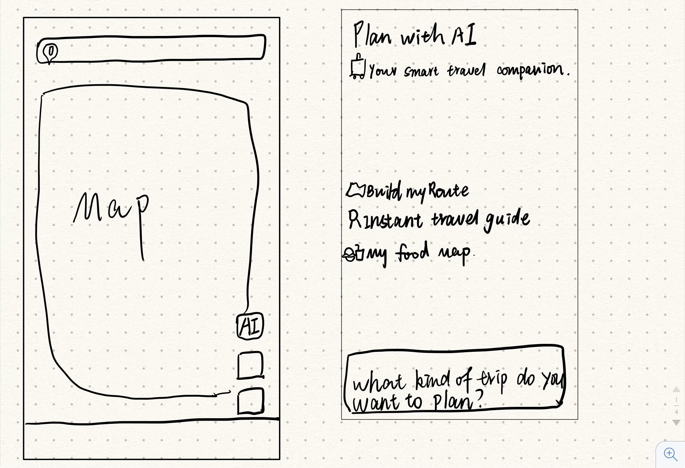
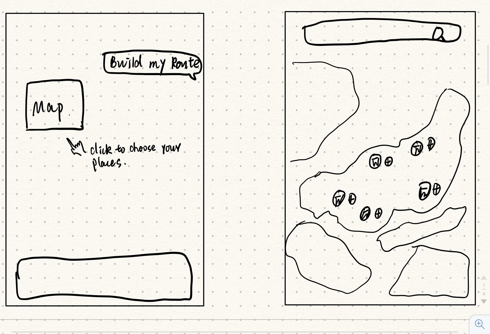
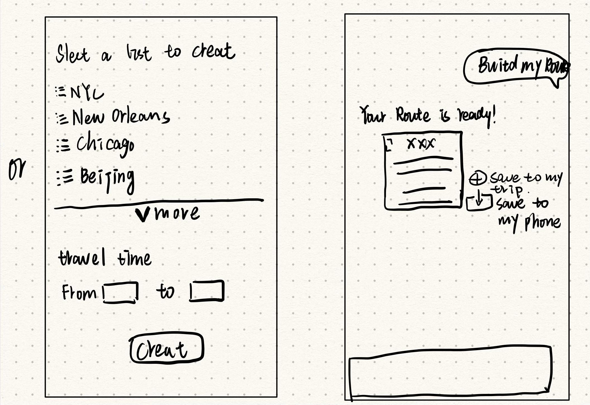
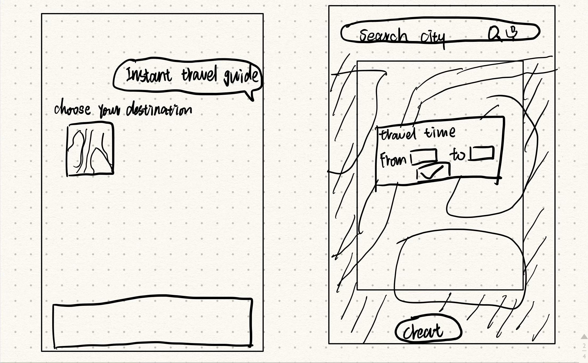
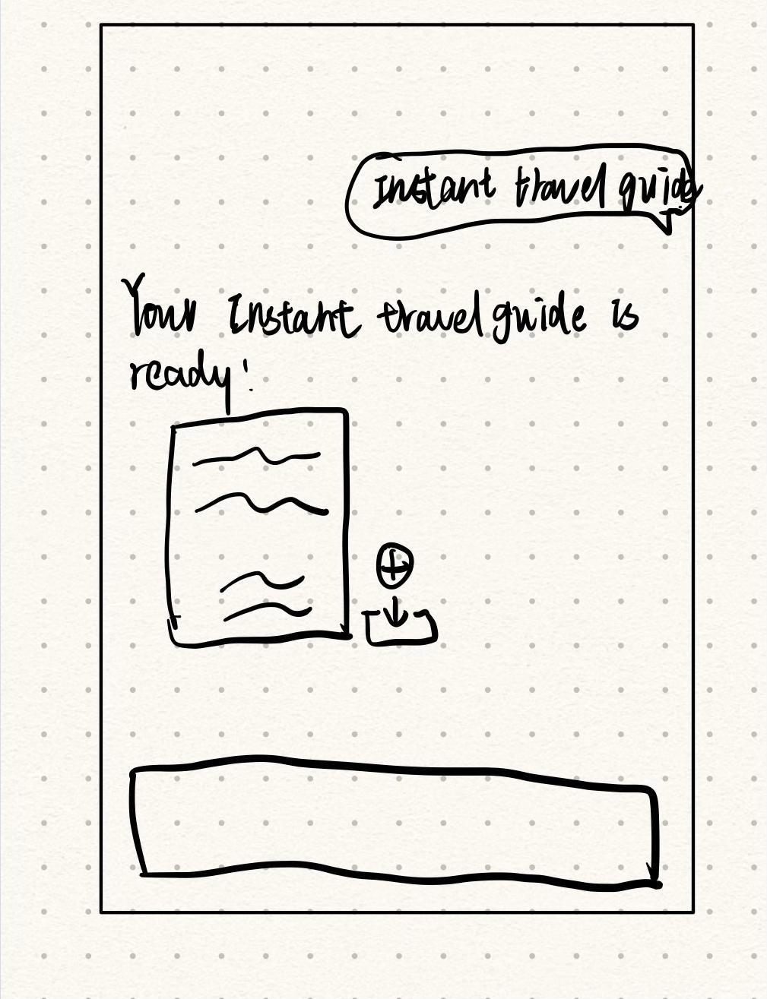

# Google Maps AI Travel Copilot

## Overview

A mobile design concept that brings trip planning and travel storytelling into a familiar map experience. Instead of treating a trip as a collection of disconnected pins, the concept connects selected places to a route and a shareable account of the journey.

**Designer:** Chloe Jian  
**Context:** MEJO 581, Sprint 4, UNC-Chapel Hill  
**Work:** concept development, ideation, wireframes, interface design, and Figma prototyping  
**Stage:** academic UI/UX concept

## Opportunity

In the project reflection, I described a familiar frustration: planning a trip often involves moving between maps, saved-place lists, notes, and sharing tools. I wanted to explore whether a copilot inside a map interface could connect those steps into a more personal travel experience.

This is a design opportunity based on my observations. It is not a market-wide claim about what Google Maps or competing products currently offer.

## Audience

I designed for young travelers who like making their own plans and sharing experiences afterward. Their intended goals shaped the concept: select places quickly, organize a route, and turn the trip into something useful to revisit or share.

## Ideation

The hand-drawn sketches explore two related paths:

1. **Build a route:** enter the copilot, choose places on a map or from a list, specify a travel period, create a route, and review the result.
2. **Create a travel guide:** choose a destination, define the time range, and generate a guide that can be saved or shared.

The sketches show early options. They should not be read as a specification of implemented behavior.

## Moving into interface design

The Figma file separates Ideas & Inspiration, Wireframes, and Mockups. The final mobile concepts use a familiar map and place-information context, then add a copilot entry and planning conversation. Route choices, map review, place details, sharing, and an itinerary view expand the journey beyond the initial prompt.

See the [screen gallery](PROTOTYPE.md) and [design decisions](DESIGN_DECISIONS.md) for the reviewed artifacts.

## Reflection

The main challenge was identifying a useful role for an embedded copilot. Producing layouts was more straightforward than deciding what the assistant should contribute to an everyday map experience. The strongest direction was connecting planning, documenting, and sharing around the same journey.

I used ChatGPT to refine English microcopy and feature descriptions. The reflection describes it as a supportive writing and ideation tool; the original concept and design decisions remained mine.

## Outcome and next steps

The sprint produced ideation sketches, wireframe and mockup pages, and an interactive Figma prototype. The supplied evidence supports the design work, not a launched AI service or measured usability improvement.

With more time, I would expand the copilot states and test how people choose, edit, and share a proposed route. A functional product would also need transparent recommendation sources, realistic travel constraints, privacy controls, failure states, and validation of generated information.

[Audience and evidence boundaries](RESEARCH_AND_SCOPE.md) · [Sources](SOURCES.md) · [Credits](../CREDITS.md)
