# Prototype and final screen gallery

[Open the interactive prototype ↗](https://www.figma.com/proto/HwjmctHseXWIb01dWQn4Li/Shitian_Jian_Sprint4?node-id=2-459&page-id=0%3A1&scaling=scale-down&content-scaling=fixed) · [Open the design file](https://www.figma.com/design/HwjmctHseXWIb01dWQn4Li/Shitian_Jian_Sprint4?node-id=0-1)

## Verified route

The following original Figma hotspots were clicked during preparation:

1. Map **AI** button → AI home (`2-459` → `2-685`).
2. **Build My Route** → route choices (`2-936`).
3. **Choose from List** → destination-list view (`2-1093`).
4. **Create** → route-ready response (`9-1422`).
5. **My NYC Weekend Route** → route map and place card (`11-1568`).
6. Expand the place card → place list (`11-1831`).
7. Share arrow → sharing-sheet mockup (`17-475`).

These are design-prototype transitions. The check does not establish editable dates, live route computation, real sharing, working third-party apps, or complete behavior for every visible control. The Maine itinerary screens were reviewed as design artifacts; their generation behavior was not separately verified.

If Figma displays its surrounding controls, use the frame arrows to browse the screens. Access remains subject to the source file's Figma sharing settings.

## Final screens

The images below were rendered at 2x from Figma's frame-to-PDF export. They retain the source layouts and proportions, without the external presentation-device frame or black canvas background. The original source's status bars, rounded screen corners, copy, and visual details remain intact.

### Map home and AI entry

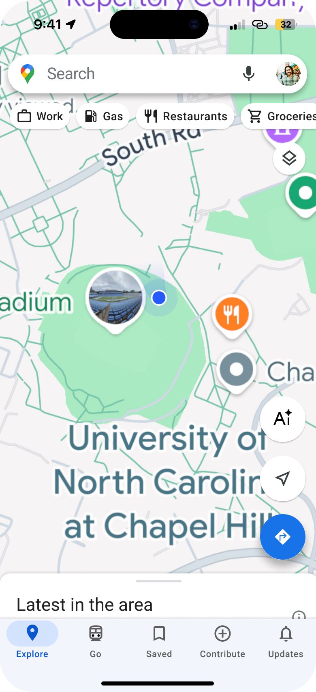

### AI home

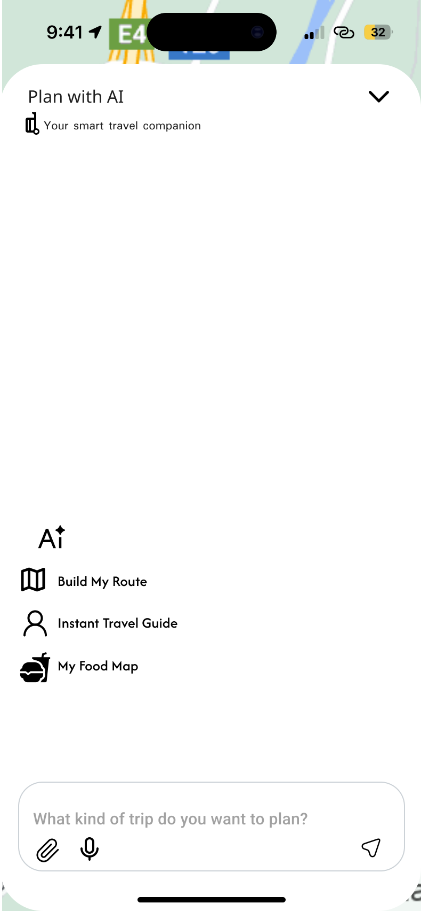

### Route creation choices

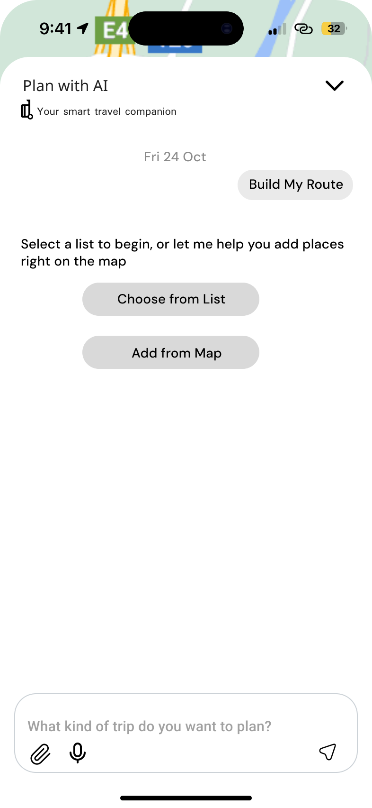

### Saved-list and date input

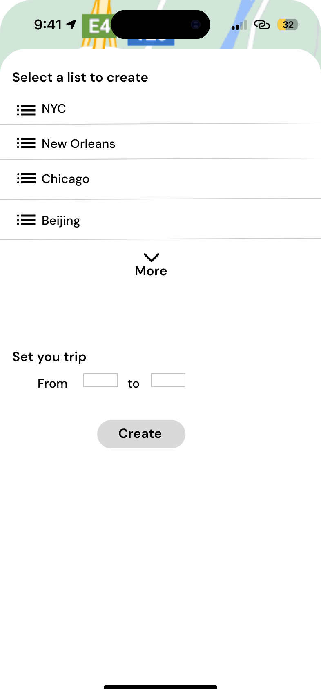

### Map-based place selection

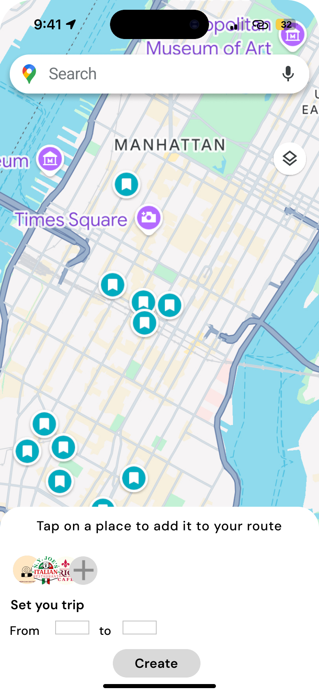

### Route-ready response

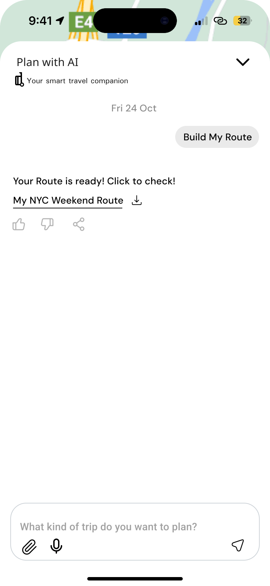

### Route map and place detail

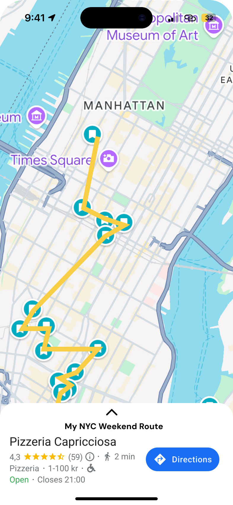

### Expanded place list

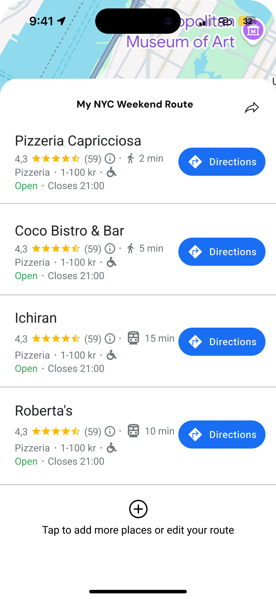

### Route-sharing sheet

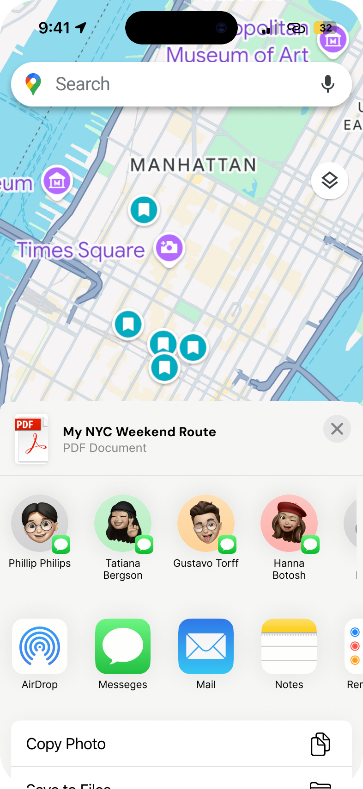

### Itinerary generation concept

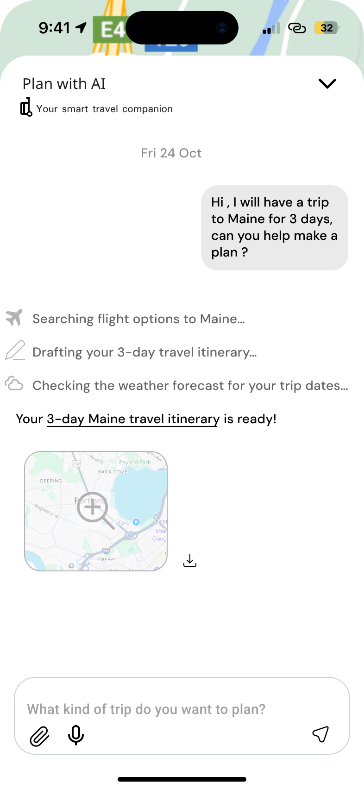

### Three-day Maine itinerary

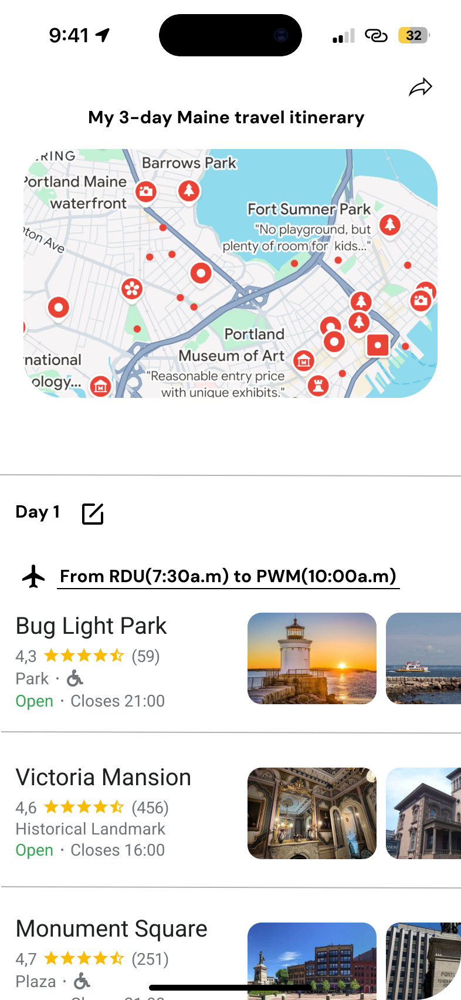

## Content notes

Location lists, ratings, prices, flight times, weather-search messages, and other travel details are mockup content. Some source labels and place metadata are inconsistent; the original artwork is preserved rather than silently rewritten. A production version would require content correction and validation. The sharing sheet is part of the design, not evidence that a message or file was sent.
