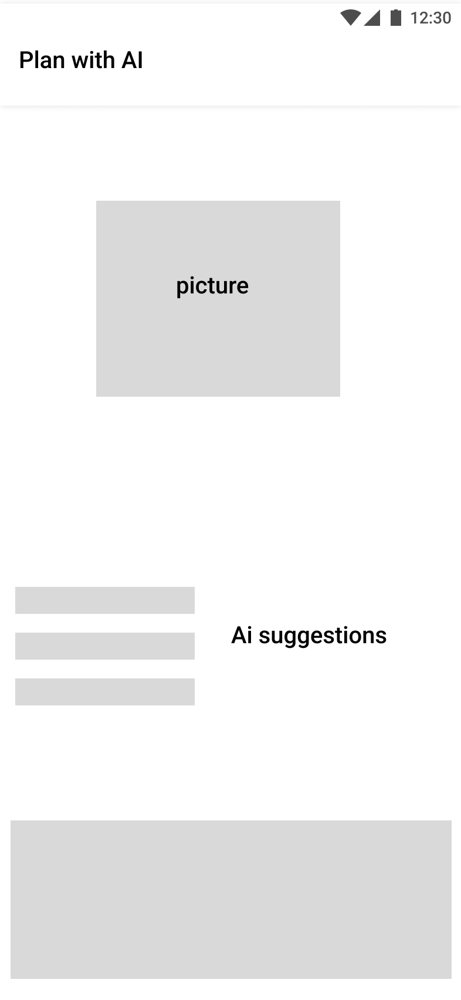
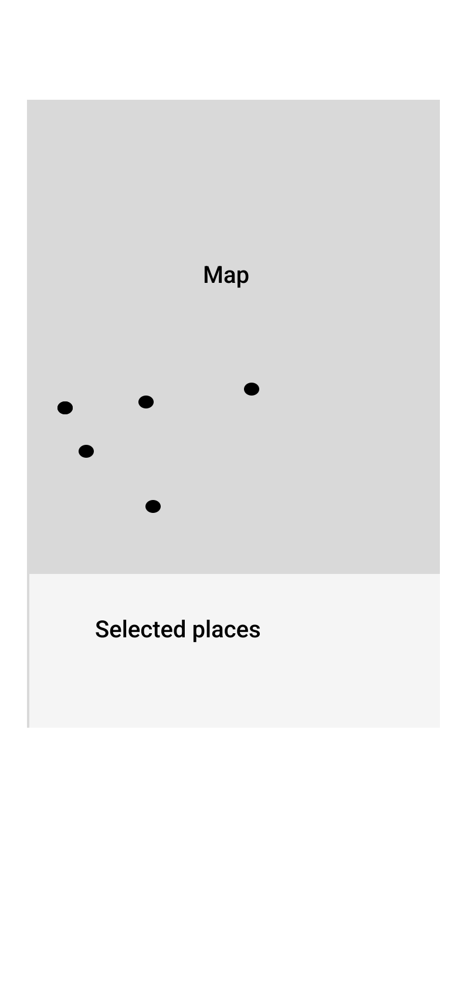
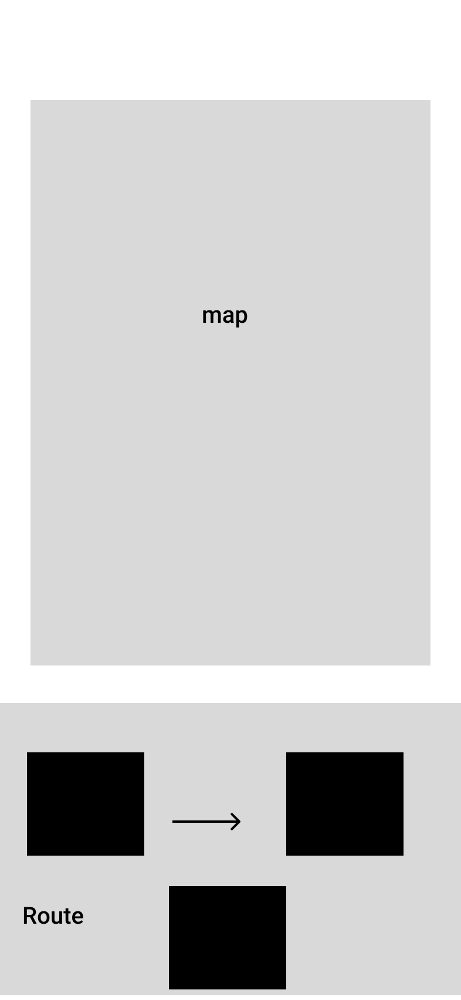
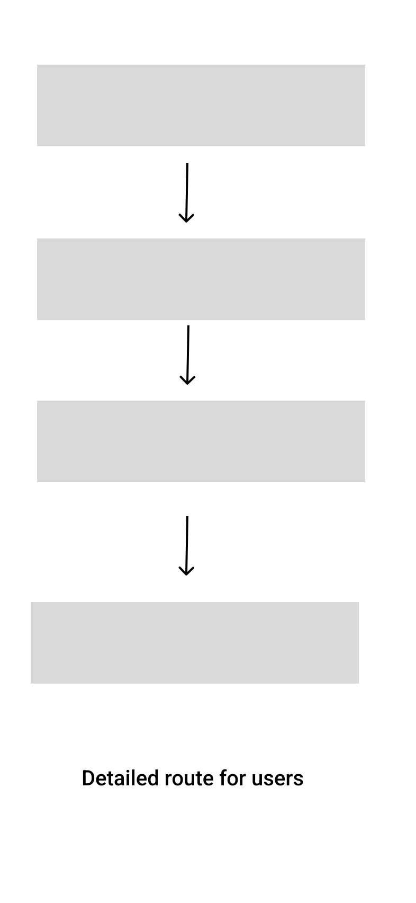
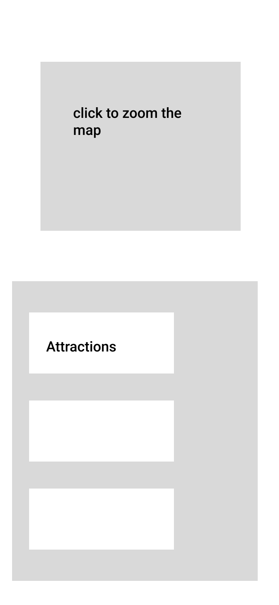

# Wireframes

[Open the original Figma wireframe page](https://www.figma.com/design/HwjmctHseXWIb01dWQn4Li/Shitian_Jian_Sprint4?node-id=11-2072)

Eleven mobile wireframe screens explore the journey before final interface styling. The Figma PDF export also includes a separate **Top Bar** component; this supporting component is omitted from the mobile-screen gallery rather than counted as a twelfth screen.

The screen order is a reading sequence for this portfolio, not proof of working interactions in the wireframe file.

### Map home and AI entry

### AI home

### Route creation choices

### Saved-list and date input

### Map-based place selection

### Route-ready response

### Route map and place detail

### Expanded place list

### Route-sharing sheet

### Itinerary generation concept

### Three-day Maine itinerary

